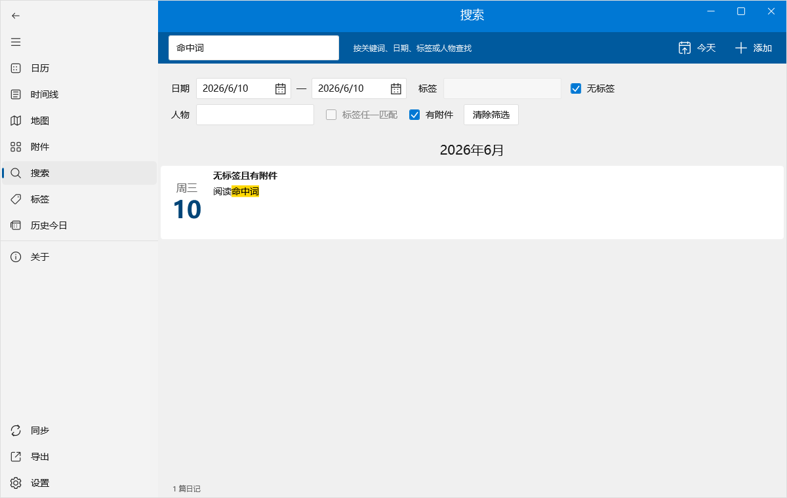
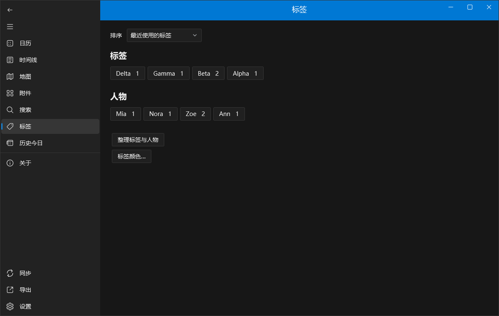
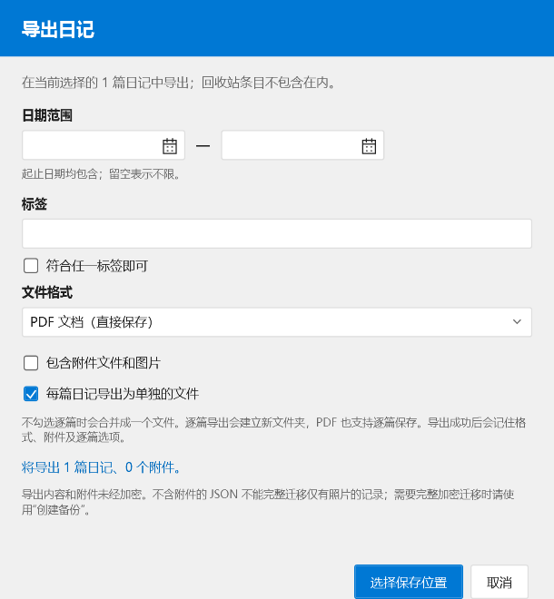

# 拾光日记

一款面向 **Windows 11 x64** 的本地日记软件。用日历和时间线回看记录，保存文字、照片和文件，也可以导出 PDF 或创建加密备份。

[下载最新版](https://github.com/CA176-web/shiguang-journal/releases/latest) · [查看 0.9.1 版本](https://github.com/CA176-web/shiguang-journal/releases/tag/v0.9.1)

## 下载与安装

推荐下载 **`拾光日记-0.9.1-Windows安装分享包_V1.zip`**，内含安装程序、使用说明和校验文件。

1. 下载 ZIP 后，右键选择“全部解压”。
2. 打开解压后的文件夹，运行 `拾光日记-0.9.1-无标签最近排序与PDF导出-x64安装包_V4.exe`。
3. 按安装向导完成安装，从开始菜单或桌面快捷方式打开“拾光日记”。

也可直接下载安装 EXE。程序自带所需运行时，无需另装 .NET；本地日记功能可离线使用。升级前请创建加密备份，保存并退出拾光，再运行新版安装包。换电脑时使用 `.journalbackup` 加密备份恢复日记和附件，具体步骤见分享包内说明。

安装包尚未配置代码签名，Windows 可能显示“未知发布者”；下载页提供对应的 SHA-256 校验文件。

## 主要功能

- **写日记**：富文本编辑，添加照片、文件和录音附件，一天可写多篇。
- **回看记录**：日历、按月时间线、日记时刻和历史今日。
- **整理与搜索**：标签、人物、标签颜色，关键词命中预览，以及日期、无标签和附件筛选。
- **导出阅读**：支持 PDF、DOCX、HTML、TXT 和 JSON，按需导出合集或逐篇文件。
- **保护与迁移**：本地加密、密码锁定、加密备份与恢复。

## 云同步与项目说明

拾光是独立项目，并非 Diarium 官方产品。本仓库用于提供 Windows 安装包和使用说明。

Google Drive 同步用于多台拾光客户端，需要自行注册 Google OAuth 桌面客户端并导入配置；安装包没有预置公共客户端。**与安卓 Diarium 的自动双向同步尚未实现**，登录同一个 Google 账号不会自动接入 Diarium 的云库。配置步骤见分享包内 `说明文档/docs/Google-Drive首次配置.md`，也可在线阅读 [Google Drive 首次配置](docs/docs/Google-Drive首次配置.md)。

## 使用文档

- [完整使用说明](docs/使用说明.md)
- [安装、升级与换电脑](docs/安装与换电脑使用说明.md)
- [第三方组件与许可证](docs/THIRD-PARTY-NOTICES.md)

## 界面预览

以下界面使用示例数据。

搜索与“无标签”筛选：

标签最近使用排序与深色主题：

导出设置：

